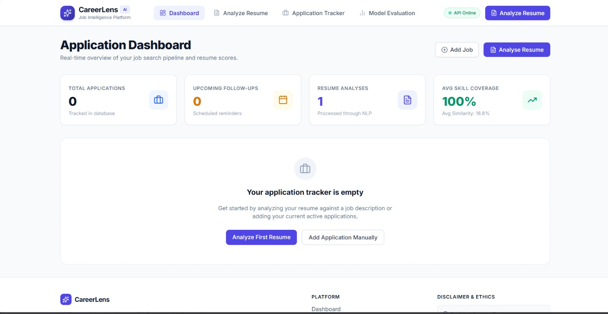
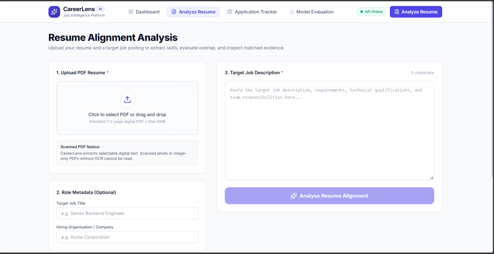
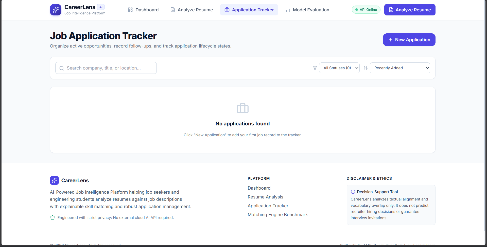
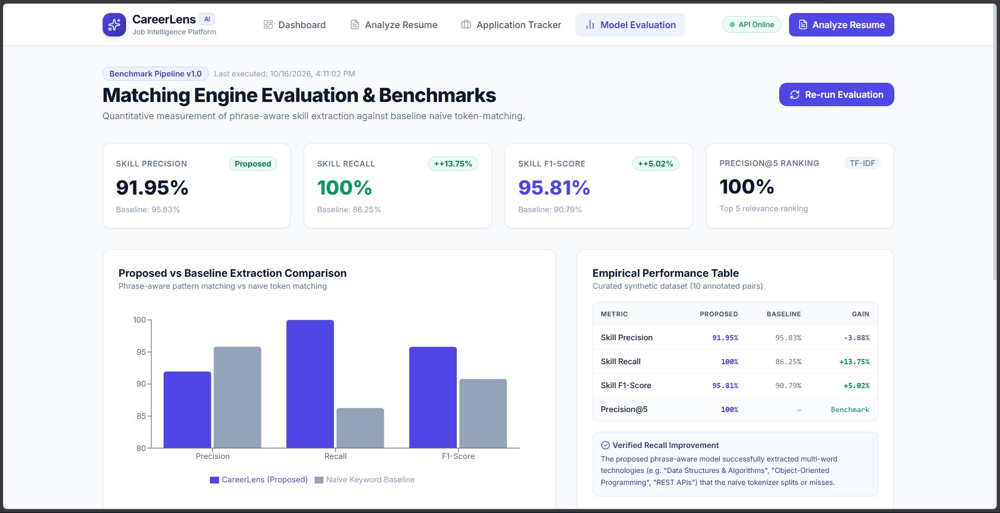

# CareerLens — AI-Powered Job Intelligence Platform

[](https://github.com/thsuhas/AI-powered-resume-to-job-matching/actions/workflows/ci.yml)
[](https://fastapi.tiangolo.com/)
[](https://react.dev/)
[](https://www.typescriptlang.org/)
[](https://vitejs.dev/)
[](https://tailwindcss.com/)
[](https://www.postgresql.org/)

CareerLens is an explainable resume-to-job matching, skill intelligence, and application management platform built for students, software engineers, and ambitious career changers.

CareerLens operates on a core ethical commitment: **it is a career-planning and decision-support tool, not an automated hiring oracle.** It never claims to predict human recruiter decisions, calculate opaque "hireability scores", or guarantee interview shortlisting.

---

## Key Features

1. **Native PDF Resume Text Extraction**: Safe extraction from uploaded PDFs via PyMuPDF (`fitz`), with content validation, encryption rejection, and clear error reporting for scanned image documents.
2. **Phrase-Aware Skill Extraction**: Multi-word token matching and canonical alias resolution (e.g. `PostgreSQL`/`postgres`, `scikit-learn`/`sklearn`, `React`/`react.js`) that prevents false positive substring matches (e.g. "Google" will never trigger "Go").
3. **Two Distinct, Explainable Scores**:
   - **Skill Coverage Score**: Percentage of required technical skills detected in the candidate's resume.
   - **TF-IDF Text Similarity**: Cosine similarity over word-frequency vectors measuring textual vocabulary overlap.
4. **Verifiable Text Evidence Snippets**: Matched skills display exact citation snippets from both the job posting and resume. Missing skills are honestly marked *"Not detected in resume"* rather than assuming candidate ignorance.
5. **Deterministic Resume Recommendations**: Actionable improvement suggestions grounded strictly in observed requirements gaps without fabricated metrics or hallucinated advice.
6. **Application Lifecycle Tracker**: Complete CRUD tracking for applications with 8 lifecycle states (`Interested`, `To Apply`, `Applied`, `Assessment`, `Interview`, `Offer`, `Rejected`, `Withdrawn`), target follow-up reminders, and salary range validations.
7. **Empirical Matching Engine Benchmarking**: Built-in evaluation pipeline running against a synthetic dataset of 10 engineering profiles, measuring Precision, Recall, F1-Score, and Precision@5 ranking against a naive keyword baseline.

---

## Screenshots

The screenshots below are placeholders until you capture and save the corresponding pages. Use demo or synthetic data only; do not include a real resume, personal contact details, browser credentials, or private application information.

| Dashboard | Resume Analysis |
| :---: | :---: |
|  |  |

| Application Tracker | Model Evaluation |
| :---: | :---: |
|  |  |

To capture them on Windows, start the app with Docker Compose and open each route in a browser. Press `Win+Shift+S`, select the page content, then open the Snipping Tool notification and save each capture using the exact path below. Check the saved image before sharing it. The `screenshots/` directory is already present.

| Page | Route | Save as |
| :--- | :--- | :--- |
| Dashboard | `http://localhost:3000/dashboard` | `screenshots/dashboard.png` |
| Resume Analysis | `http://localhost:3000/analyze` | `screenshots/resume-analysis.png` |
| Application Tracker | `http://localhost:3000/applications` | `screenshots/application-tracker.png` |
| Model Evaluation | `http://localhost:3000/evaluation` | `screenshots/model-evaluation.png` |

---

## Architectural Overview

```
careerlens/
├── backend/
│   ├── alembic/                # Database migrations
│   │   ├── versions/           # Migration revisions (001_initial_schema.py)
│   │   └── env.py
│   ├── app/
│   │   ├── api/
│   │   │   ├── routers/        # Health, Applications, Analyses, Dashboard, Evaluation
│   │   │   └── deps.py
│   │   ├── evaluation/         # Benchmark pipeline, synthetic dataset, metrics
│   │   ├── models/             # SQLAlchemy ORM models (JobApplication, ResumeAnalysis, AnalysisEvidence)
│   │   ├── nlp/                # PyMuPDF extractor, normalizer, skill extractor, TF-IDF matcher
│   │   ├── schemas/            # Pydantic v2 schemas and validators
│   │   ├── config.py           # Application settings
│   │   ├── database.py         # SQLAlchemy engine and session factory
│   │   └── main.py             # FastAPI entrypoint with CORS & middleware
│   ├── tests/                  # Pytest automated test suite (24 tests)
│   ├── requirements.txt
│   ├── alembic.ini
│   └── Dockerfile
├── frontend/
│   ├── src/
│   │   ├── api/                # Typed API client
│   │   ├── components/         # Reusable UI components (Navbar, Footer, StatusBadge, ScoreCard, Modals)
│   │   ├── pages/              # Landing, Dashboard, ResumeAnalysis, MatchDetails, Tracker, Evaluation
│   │   ├── test/               # Vitest component test suite (10 tests)
│   │   ├── types/              # TypeScript interface definitions
│   │   ├── App.tsx             # React Router routing
│   │   └── main.tsx
│   ├── Dockerfile
│   ├── nginx.conf
│   └── package.json
├── docker-compose.yml          # Multi-container orchestration (PostgreSQL + FastAPI + Nginx)
├── .env.example
├── .gitignore
├── pytest.ini
└── README.md
```

---

## Quickstart & Local Setup

### Prerequisites
- Python 3.11 (the CI-tested version) and pip for local backend development
- Node.js 22 and npm for local frontend development
- Docker Desktop with Docker Compose v2 for the containerized stack
- PostgreSQL for a local PostgreSQL setup, or use SQLite for local development

### 1. Clone & Set Up Environment Variables
From Windows PowerShell at the project root, create `.env` only when it does not already exist:
```powershell
if (-not (Test-Path .env)) { Copy-Item .env.example .env }
```
Keep `.env` private. For local backend development, the example uses SQLite. For Docker, set a unique local `POSTGRES_PASSWORD` in the root `.env`; `POSTGRES_USER` and `POSTGRES_DB` configure the Compose database. Compose builds the backend `DATABASE_URL` using the internal hostname `db`, so do not set it to `localhost` for the containerized backend. `CORS_ORIGINS` configures allowed browser origins. `VITE_API_BASE_URL` is used by Vite for local frontend development; the Docker image uses same-origin `/api` and Nginx proxies requests to the backend.

### 2. Backend Setup
```bash
# Create and activate Python virtual environment
python -m venv .venv
# Windows PowerShell:
.venv\Scripts\activate
# Linux/macOS:
source .venv/bin/activate

# Install dependencies
pip install -r backend/requirements.txt

# Run database migrations (creates SQLite or PostgreSQL schema)
cd backend
alembic upgrade head
cd ..

# Start the FastAPI backend server
uvicorn backend.app.main:app --reload --host 0.0.0.0 --port 8000
```
Backend API will be running at `http://localhost:8000`. OpenAPI Swagger documentation is available at `http://localhost:8000/docs`.

### 3. Frontend Setup
In a new terminal:
```bash
cd frontend

# Install dependencies
npm install --legacy-peer-deps

# Start Vite development server
npm run dev
```
Frontend application will be running at `http://localhost:5173`.

---

## Docker Setup (Compose)

The Compose stack runs PostgreSQL 15, the FastAPI backend, and the Nginx frontend. Compose reads PostgreSQL credentials from the root `.env`; keep the existing file and set a unique local `POSTGRES_PASSWORD` there before starting. The backend connects to `db:5432` on the Compose network. The Docker frontend uses the same-origin `/api` path, which Nginx proxies to the backend service.

```bash
# Run from the project root in Windows PowerShell
docker compose up --build -d

# Check service status and the API/database health response
docker compose ps
curl.exe -fsS http://localhost:8000/api/health
curl.exe -fsS http://localhost:3000/api/health
```

Open the frontend at `http://localhost:3000`. The direct backend API and Swagger UI are available at `http://localhost:8000` and `http://localhost:8000/docs`; PostgreSQL is published on `localhost:5432`. The frontend's `/api` requests go through Nginx to `backend:8000`, so the browser does not need to resolve a container hostname.

Compose stores PostgreSQL data in the named `postgres_data` volume. Stop the stack without deleting database data with:

```bash
docker compose down
```

Do not add `-v` unless you intentionally want to delete the persistent PostgreSQL data.

---

## Automated Test Suites

### Backend Tests (pytest)
From the project root with the virtual environment active:
```bash
python -m pytest -v
```

### Frontend Type Check, Tests, and Build
From `frontend/`, install dependencies once, then run the test suite and production build (the build script runs TypeScript project checking before Vite):
```bash
npm install --legacy-peer-deps
npm test
npm run build
```

### Evaluation Benchmark Pipeline
From the project root, execute the benchmark over its synthetic dataset. It computes Precision, Recall, F1, and ranking metrics and writes generated JSON/Markdown reports under `backend/app/evaluation/`:
```bash
python -m backend.app.evaluation.pipeline
```

---

## Benchmark Evaluation Results

The CareerLens matching engine was evaluated against a synthetic benchmark dataset of 10 engineering profiles across diverse roles (Backend, Frontend, ML/NLP, DevOps, Systems, QA, Database Administration):

| Metric | Proposed Method (Phrase-Aware) | Baseline Method (Naive Overlap) | Difference |
| :--- | :---: | :---: | :---: |
| **Precision** | **91.95%** | 95.83% | -3.88% |
| **Recall** | **100.00%** | 86.25% | **+13.75%** |
| **F1-Score** | **95.81%** | 90.79% | **+5.02%** |
| **Precision@5 (Ranking)** | **100.00%** | — | Benchmark Target |

*Interpretation:* On these 10 synthetic pairs, phrase-aware extraction trades 3.88 percentage points of precision for 13.75 points of recall and 5.02 points of F1 versus the naive baseline. These curated benchmark figures are not estimates of production performance; the matching algorithm was not adjusted to optimize this benchmark.

---

## REST API Reference

| Method | Endpoint | Description |
| :--- | :--- | :--- |
| `GET` | `/api/health` | Health check verifying database connectivity |
| `POST` | `/api/applications` | Create a new job application record |
| `GET` | `/api/applications` | List applications with pagination, search, status filter, and sorting |
| `GET` | `/api/applications/{id}` | Retrieve single job application details |
| `PATCH` | `/api/applications/{id}` | Update application status, follow-up date, or notes |
| `DELETE` | `/api/applications/{id}` | Delete job application |
| `POST` | `/api/analyses` | Upload PDF & job description, compute match analysis |
| `GET` | `/api/analyses` | List past resume analyses |
| `GET` | `/api/analyses/{id}` | Retrieve full analysis with evidence snippets |
| `DELETE` | `/api/analyses/{id}` | Delete analysis record |
| `GET` | `/api/dashboard/summary` | Aggregated dashboard stats and recent records |
| `GET` | `/api/dashboard/status-distribution` | Breakdown of applications by status for charts |
| `GET` | `/api/dashboard/upcoming-followups` | Scheduled follow-up reminders |
| `GET` | `/api/evaluation/summary` | Matching engine evaluation metrics and comparisons |
| `POST` | `/api/evaluation/run` | Trigger fresh execution of the evaluation pipeline |

---

## Known Limitations & Boundaries

1. **Digital PDF Requirement**: CareerLens extracts selectable digital text using PyMuPDF. Photo scans or image-only PDFs require an external OCR service (such as Tesseract), which is intentionally excluded to preserve lightweight, zero-cloud execution.
2. **Keyword-Based Skill Matching**: Phrase-aware matching, aliases, and TF-IDF text similarity do not provide general semantic understanding. Matching depends on explicit vocabulary and the curated dictionary in `backend/app/nlp/skills_db.json`; unlisted skills may not be detected.
3. **No Context or Negation Understanding**: Keyword matching does not reliably distinguish context or negation (for example, "We do not use Python" versus "Must know Python").
4. **Single-User Deployment Model**: In its initial release, CareerLens is designed as a personal decision-support workbench and single-tenant demo without user authentication.

---

## License

MIT License. Designed and engineered for transparent career intelligence.
